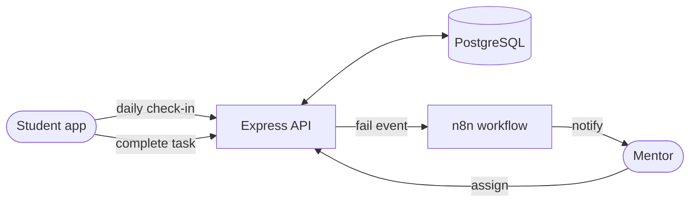
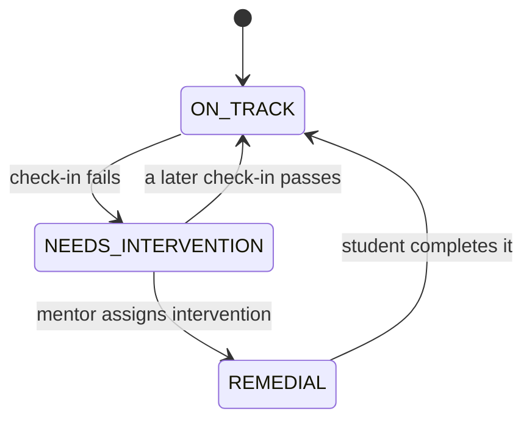

# Alcovia Intervention System: High-Level Design

Automatically flags students who fall behind, routes them to a mentor and unlocks them after remedial work. For code-level detail see the [Low-Level Design](lld.md).

## 1. System context

## 2. Student states

## 3. Components

| Component | Responsibility |
|---|---|
| Express API (`src/app.js`) | Check-in rule, intervention workflow, status updates |
| PostgreSQL (`src/db.js`) | Students, daily logs and interventions |
| n8n | Sends the mentor notification (email, chat, etc.) when an intervention is created |

## 4. Rules

| Rule | Value |
|---|---|
| Pass | `quiz_score > 7` **and** `focus_minutes > 60` |
| Unknown student on check-in | Created automatically as "Unknown Student" |
| Webhook failure | Logged; does not block the check-in response |
