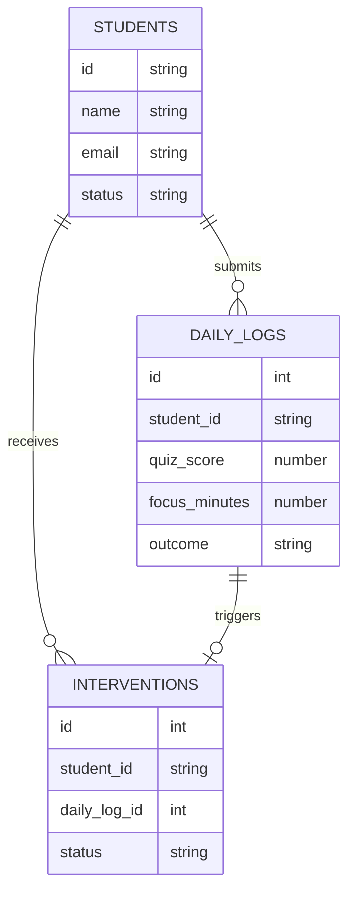
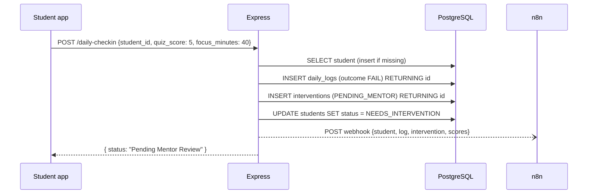

# Alcovia Intervention System: Low-Level Design

For the big picture see the [High-Level Design](hld.md).

## 1. Data model

| Field | Values |
|---|---|
| `students.status` | `ON_TRACK`, `NEEDS_INTERVENTION`, `REMEDIAL` |
| `daily_logs.outcome` | `PASS`, `FAIL` |
| `interventions.status` | `PENDING_MENTOR`, `ASSIGNED`, `RESOLVED` |

## 2. Endpoints

| Route | Steps | Errors |
|---|---|---|
| `POST /daily-checkin` | Validate body → create student if missing → insert daily log with outcome → PASS: set ON_TRACK, return "On Track" → FAIL: insert intervention (PENDING_MENTOR), set NEEDS_INTERVENTION, fire webhook, return "Pending Mentor Review" | 400 missing fields, 500 |
| `POST /assign-intervention` | Set intervention ASSIGNED (matching id and student) → student REMEDIAL | 400 missing params or not found, 500 |
| `POST /complete-intervention` | Set the student's ASSIGNED intervention RESOLVED → student ON_TRACK | 400 missing id or none active, 500 |

## 3. Failed check-in sequence

## 4. Configuration

PostgreSQL settings come from `DB_*` variables with SSL enabled; `N8N_WEBHOOK_URL` is optional. `socket.io` is installed but not used yet.
